# Distributed control of a Duckiebot fleet

<p align="center">
  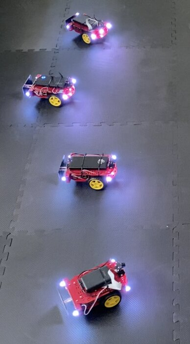
  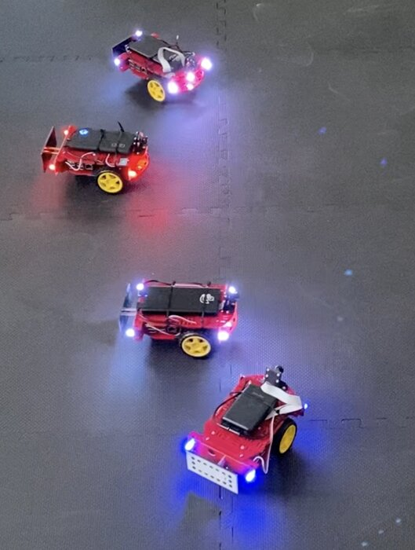
</p>

Networked and distributed control of a fleet of **Duckiebots**, small differential-drive robots running ROS. The work
follows a V-model: Simulink simulation with a model of the network, emulation in ROS with the robots lifted off the
ground, and tests with up to four real robots.

Project of the **Distributed Algorithms and Cyber-Physical Systems Design** course, M.Sc. in Automation Engineering and
Robotics, University of Naples Federico II, 2024.

## Robot model and control

- **Kinematics.** Differential drive with a wheelbase of 12.32 cm and a wheel radius of 3.18 cm, simulated with the
  Differential Drive Kinematic Model block of Robotics System Toolbox.
- **Posture regulation.** Each robot is driven to a target pose with a control law in polar coordinates, where ρ is the
  distance from the target, γ the bearing error and δ = γ + θ:

```math
v = k_1 \rho \cos\gamma, \qquad
\omega = k_2 \gamma + k_1 \sin\gamma \cos\gamma \left(1 + k_3 \frac{\delta}{\gamma}\right), \qquad
\omega_{R,L} = \frac{2v \pm \omega l}{2r}
```

- **State reconstruction.** The only sensors are the wheel encoders, with about 135 ticks per wheel revolution. The pose
  is integrated with a second-order Runge-Kutta scheme:

```math
x_{k+1} = x_k + v_k T_s \cos\!\left(\theta_k + \tfrac{1}{2}\omega_k T_s\right), \quad
y_{k+1} = y_k + v_k T_s \sin\!\left(\theta_k + \tfrac{1}{2}\omega_k T_s\right), \quad
\theta_{k+1} = \theta_k + \omega_k T_s
```

## Simulation

The Simulink models are in [`simulation/`](simulation). The single-robot model started from a course exercise.

<div align="center">

| Folder | What it simulates |
|:---:|:---:|
| `posture_regulation/` | One robot, with the pose reconstructed from the wheel speeds |
| `centroid/` | Two robots: their centroid is driven to the origin, with each robot at an offset from it |
| `network/` | The same two robots, with a network between controller and robots in both directions |

</div>

- **Network model.** The link is a queue, $`\dot q = r - c`$, limited by the buffer B, with a random component on the
  transmission rate. The queue adds a delay $`q/c`$, to which a propagation delay is added. When the queue exceeds the
  bandwidth, packets are lost and the received value is replaced by a first-order estimator,
  $`\hat u_{k+1} = (1 - a)\hat u_k + a u_k`$.
- **Dynamic rate.** The transmission rate switches between 8 and 3 depending on the state of the queue, to limit
  congestion.

<div align="center">

| Packet loss, no estimator | Packet loss, with estimator | Malicious attack |
|:---:|:---:|:---:|
| 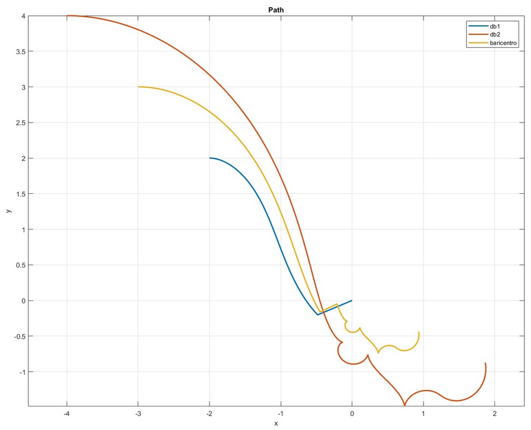 | 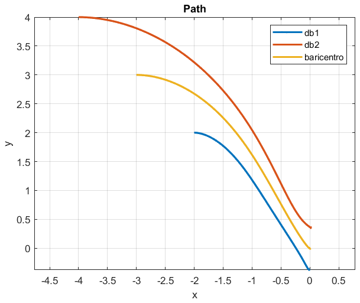 | 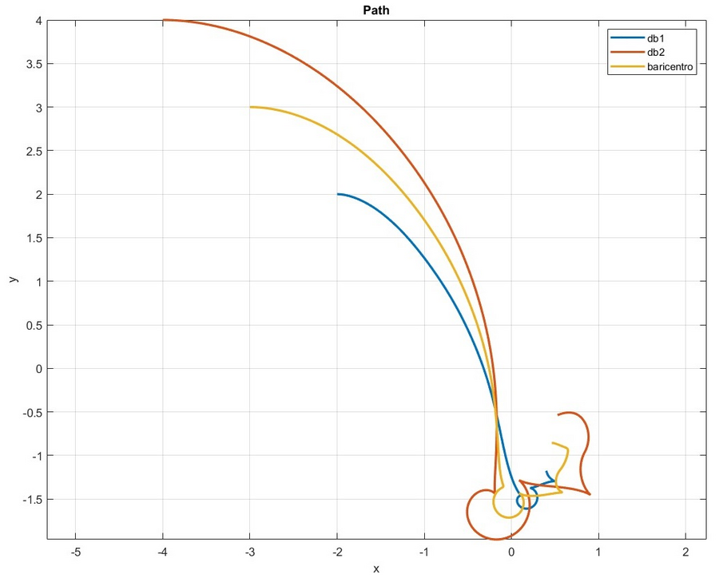 |

</div>

- **Packet loss.** Without the estimator the queue saturates after about 4 s and the robots wander. With the estimator
  and the dynamic rate they follow the expected paths and the centroid reaches the origin.
- **Attack.** From t = 2 s the rate jumps above the bandwidth (C = 6, B = 8) and the queue never empties: the estimator
  compensates for a while, then the robots lose the reference.
- **Delay.** With 1 ms the paths are unchanged and only the velocities become less smooth. With 0.3 s the robots still
  reach the target, along different paths.

### Consensus and fleet control

These analyses were done in MATLAB scripts that are not in this repository; the figures come from the project report.

- **Consensus.** Four nodes on a ring exchange their positions with the discrete-time law
  $`x_{k+1} = (I - \varepsilon L)\,x_k`$, with ε = 0.3, below the bound 1/d<sub>max</sub> = 0.5. The consensus value is
  the average of the positions, that is the centroid of the fleet.
- **Variants.** External inputs, weighted nodes, a leader node, accumulation variables against link faults, and
  multi-hop communication with the 2-hop neighbours, which converges faster.
- **Faults.** With accumulation variables, a node that loses all its links at step 50 no longer affects the others,
  which agree on the average of their own values. When it reconnects, the network moves to a new consensus that
  includes what the node received meanwhile. At step 120 only its outgoing link fails.

<div align="center">

| Consensus with a faulty node (x and y) | Fleet, no offset | Fleet, with offsets |
|:---:|:---:|:---:|
| 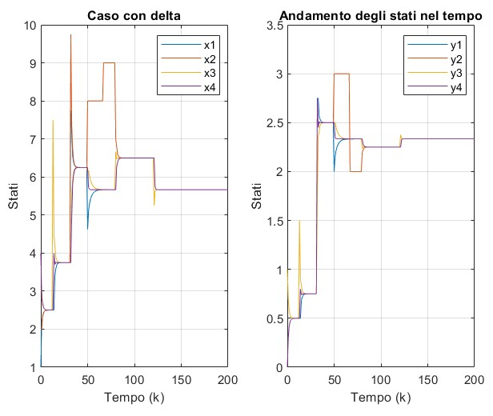 | 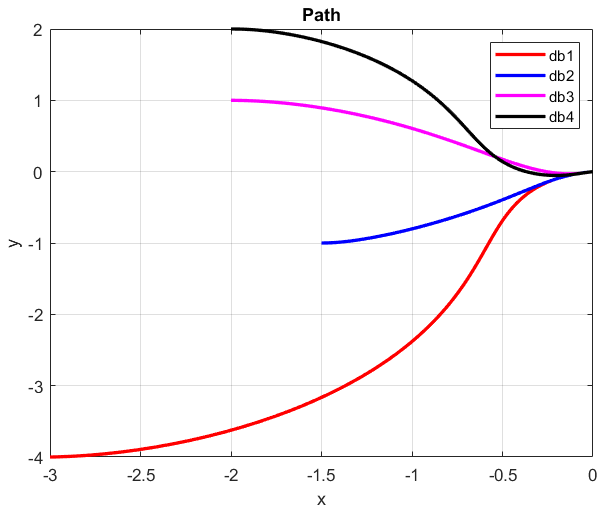 | 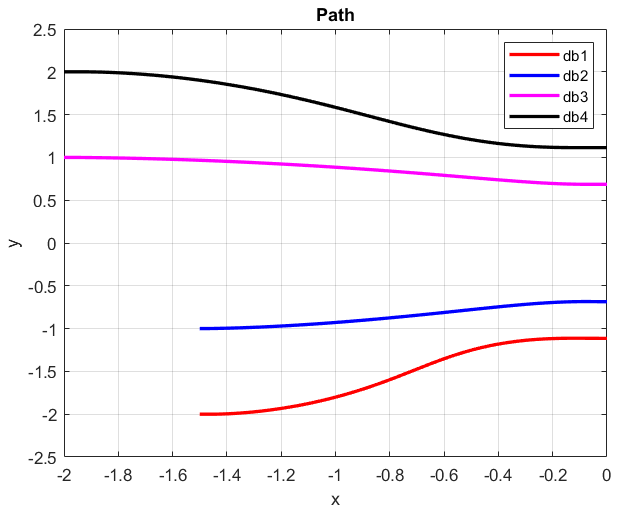 |

</div>

- **Fleet control.** Each robot runs posture regulation towards the estimated centroid plus its own offset (−1.3,
  −0.7, 0.7 and 1.3 m along y). The centroid estimate converges faster than the robots move.

## Emulation in ROS

The ROS packages are in [`ROS/catkin_ws/src`](ROS/catkin_ws/src). In the emulation the robots stand upright with the
wheels off the ground, and their poses, reconstructed from the encoders, are shown in RViz. Each Duckiebot runs its own
ROS master; the PC connects to all of them over Wi-Fi with FKIE multimaster (`master_discovery` and `master_sync`).

- **Centralized control, two robots** (`centralizzato`). A node on the PC computes the centroid and commands both
  robots, keeping them 0.3 m from it, along a straight and a curved path.
- **Decentralized control, four robots** (`distribuito`). The robots form a ring. Each one has a state reconstruction
  node (`ricostruzione`) and a control node (`controllo`), which estimates the centroid from its two neighbours with
  the consensus algorithm with accumulation variables. When a robot fails, its neighbours change the colour of their
  LEDs.

<p align="center">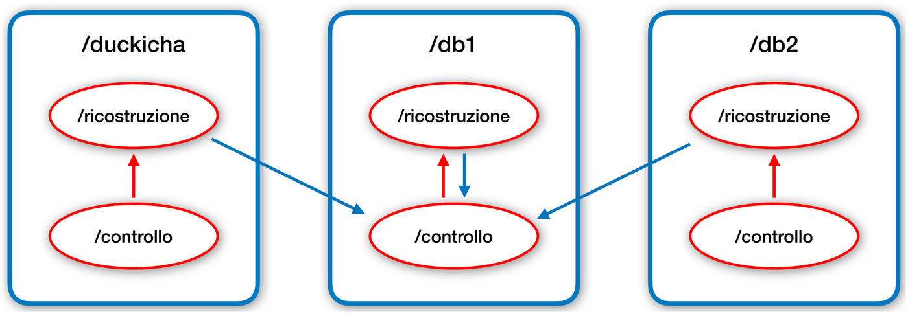</p>

<div align="center">

| Decentralized control | With a faulty robot |
|:---:|:---:|
| 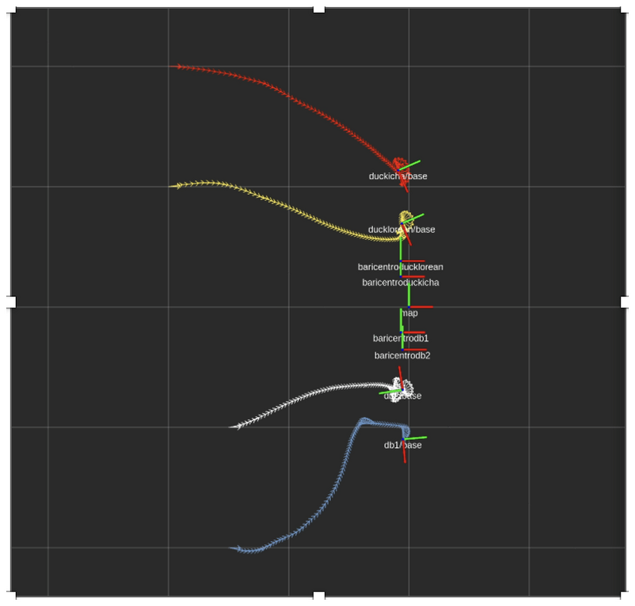 | 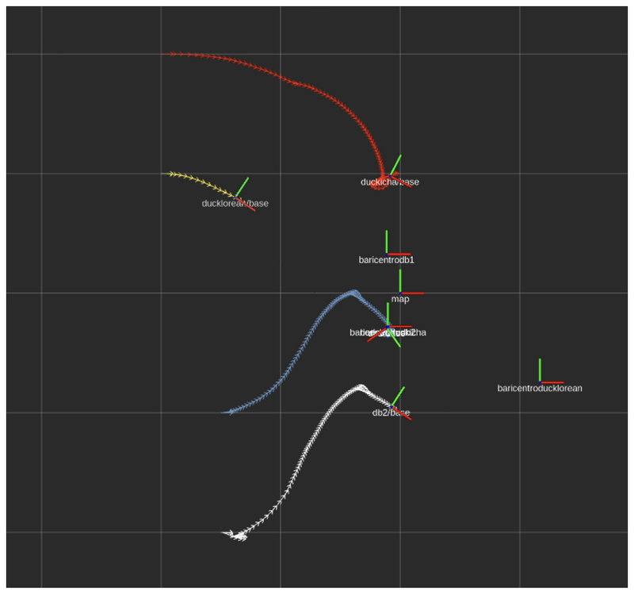 |

</div>

Emulation with a faulty robot, with the robots lifted off the desk:

https://github.com/user-attachments/assets/c0334f6c-eb83-4adb-81c3-4a9b9aac2519

## Real robots

The PC and the robots were connected through a smartphone hotspot (2.4 GHz Wi-Fi).

- **Ceramic floor, two robots.** On a simple straight path the robots behave as in the emulation. With other initial
  poses the paths become distorted, because of the hardware: out-of-round wheels, axles not perpendicular to the body,
  imprecise treads that slip, a deformed caster wheel and an asymmetric chassis. A cascade controller gave the same
  results.
- **EVA foam mat.** Centralized control with two robots and decentralized control with four, also with a faulty node,
  give similar results. Close to the target, at low speed, the motors do not provide enough torque to move the robots
  on this surface.

Two robots on the ceramic floor:

https://github.com/user-attachments/assets/ff818601-bc20-450a-a46b-7acd6316d434

Four robots with the consensus algorithm:

https://github.com/user-attachments/assets/73277934-7796-4354-b55e-b91f41e017ca

Four robots with a faulty node:

https://github.com/user-attachments/assets/0a1e66d1-dba6-4800-a14b-339cb2b1e79a


## Limitations

- On the real robots the poses come only from wheel odometry, with no external tracking, so the accuracy on the floor
  is not measured.
- In the launch scripts all the nodes run on the PC: the control is decentralized in the information each node uses,
  not in where it runs.
- The network model is saved in its last configuration (C = 6); the script lists the other values that were tried.
- The scripts assume fixed host names (`db1`, `db2`, `ducklorean`, `duckicha`, PC `ubuntu.local`) and fixed folders.

## How to run it

### Simulation

Requirements:

- MATLAB and Simulink (the models were saved with R2022b);
- Robotics System Toolbox, for the Differential Drive Kinematic Model block.

From each folder in `simulation/` run its script, which also plots the results:

```matlab
posture_regulation   % in simulation/posture_regulation
centroid_control     % in simulation/centroid
network_control      % in simulation/network
```

### ROS

1. Build `ROS/catkin_ws` on the PC; the scripts expect the workspace in `~/catkin_ws`. The Duckiebots run the
   standard Duckietown software and must be reachable as `<name>.local`.
2. The scripts in `ROS/centralizzatoSH` and `ROS/distribuitoSH` open several terminals with `terminator` and
   `xdotool`, and expect these folders on `~/Desktop`.
3. For the decentralized control, in this order:
   - `final_dec.sh` starts master discovery for the four robots, then each `sync/sync_<robot>.sh` starts the
     synchronization;
   - `ricostruzione.sh` starts the four state reconstruction nodes, with the initial poses set in
     `ricostruzione/ric_<robot>.sh`;
   - `controllo.sh` starts the four control nodes; the offsets are in the launch files of `distribuito`;
   - RViz with `distribuito.rviz` shows the fleet;
   - `stopDec.sh` stops the robots, `resetLED.sh` resets the LEDs and `spegni.sh` shuts the robots down.
4. For the centralized control, `centralized.sh` starts master discovery and synchronization for `db1` and `db2`, and
   the nodes are in the `centralizzato` package.

Names in Italian: *centralizzato* centralized, *distribuito* distributed, *ricostruzione* state reconstruction,
*controllo* control, *baricentro* centroid, *spegni* shut down.

## Third-party packages

`ROS/catkin_ws/src` also contains the packages the project was built with, kept as they were used, so they may differ
from the upstream versions:

- `duckietown` and `duckietown_msgs`, from [Duckietown](https://github.com/duckietown/dt-ros-commons) (GPLv3);
- `multimaster`, [FKIE multimaster](https://github.com/fkie/multimaster_fkie) by Alexander Tiderko (BSD; some icons
  under LGPL or CC BY-NC 3.0).

## Repository structure

```
├── simulation/
│   ├── posture_regulation/      one robot
│   ├── centroid/                two robots, centroid control
│   └── network/                 two robots through the network model
├── ROS/
│   ├── catkin_ws/src/
│   │   ├── centralizzato/       centralized control (C++)
│   │   ├── distribuito/         decentralized control (C++)
│   │   └── duckietown/, duckietown_msgs/, multimaster/   third-party packages
│   ├── centralizzatoSH/         scripts for the centralized control
│   ├── distribuitoSH/           scripts for the decentralized control
│   └── rosgraph.png             ROS graph
└── docs/media/                  figures of this README
```
